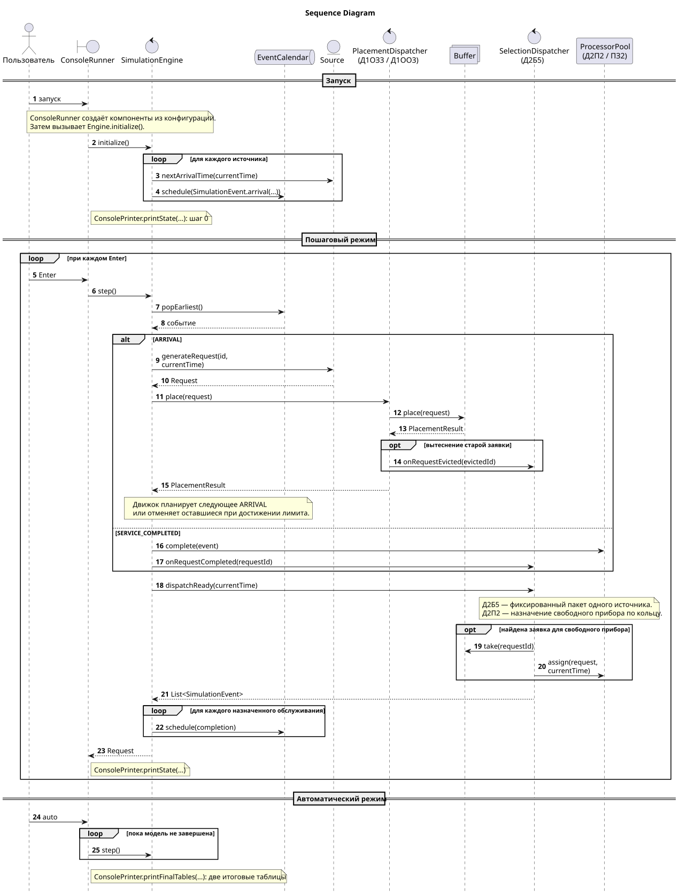
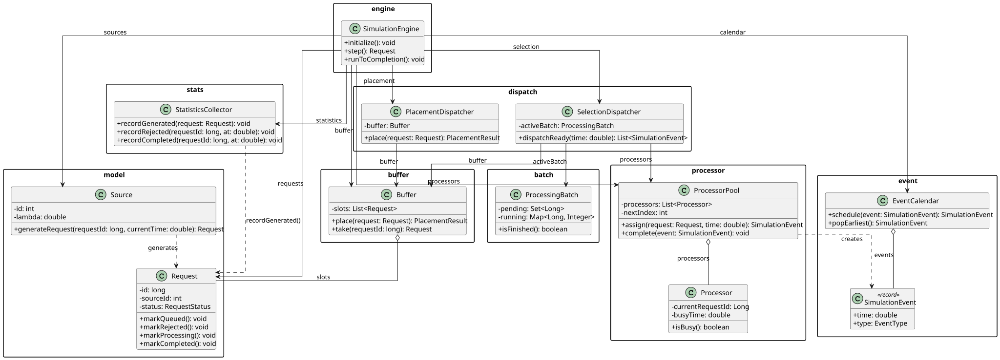
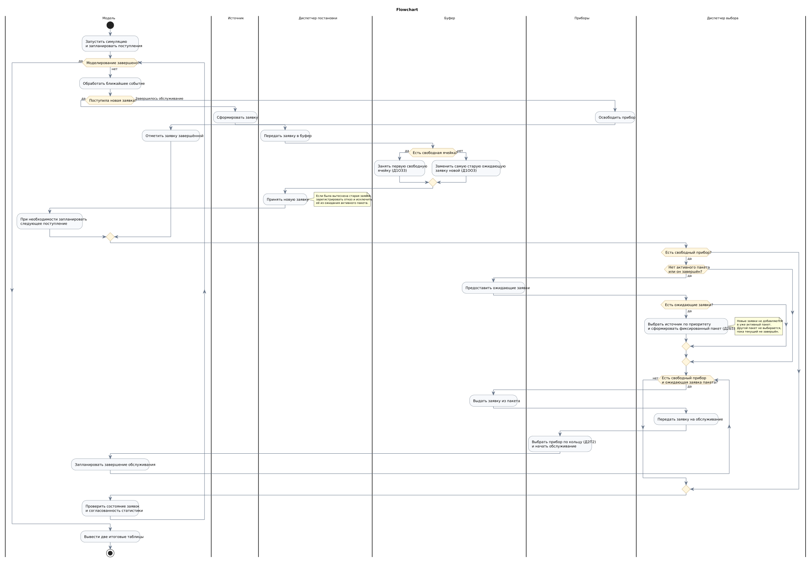

# Система управления грузовыми перевозками — вариант 14

**Филонова Ангелина Владиславовна**  
Группа **5130904/40106**

Система массового обслуживания моделирует обработку заявок на перевозку грузов в логистической компании. Заявки поступают через корпоративный портал, мобильное приложение и внешние сервисы. Когда обработчики заняты, запросы ожидают в ограниченном буфере. При освобождении обработчика диспетчер формирует фиксированный пакет ожидающих заявок одного источника и назначает их свободным обработчикам. Обработка включает проверку параметров перевозки, поиск подходящего транспорта и формирование задания на перевозку.

## Элементы модели

| **Элемент СМО** | **Бизнес-сущность** |
| --- | --- |
| Источник | Канал поступления заявок: корпоративный портал, мобильное приложение, внешний сервис |
| Заявка | Запрос на перевозку груза с данными об отправлении, назначении и параметрах груза |
| Буфер | Общая ограниченная очередь ожидающих заявок |
| Прибор | Обработчик системы диспетчеризации, проверяющий и распределяющий заявки |
| Диспетчер постановки | Размещает заявки в буфере; при заполнении вытесняет старейшую ожидающую заявку |
| Диспетчер выбора | Формирует пакет заявок одного источника и распределяет их по обработчикам |
| Пакет | Фиксированный набор заявок одного источника на момент выбора |
| Отказ | Вытеснение самой старой ожидающей заявки при переполнении буфера |

## Формула варианта

**ИБ ИЗ1 ПЗ2 Д1ОЗ3 Д1ОО3 Д2П2 Д2Б5 ОР1 ОД2**

| **Код** | **Правило модели** |
| --- | --- |
| ИБ | Бесконечный источник: клиенты и внешние сервисы логистической компании формируют заявки на грузоперевозки независимо от завершения предыдущих. |
| ИЗ1 | Пуассоновский поток заявок на перевозку: интервалы между поступлениями распределены экспоненциально. |
| ПЗ2 | Обработка включает проверку параметров перевозки и поиск подходящего транспорта. Время обработки заявки диспетчером распределено равномерно. |
| Д1ОЗ3 | Новая заявка на перевозку размещается в первой свободной ячейке ограниченного буфера, начиная с его начала. |
| Д1ОО3 | При переполнении буфера удаляется самая старая ожидающая заявка на перевозку. Она получает отказ и учитывается в статистике. |
| Д2П2 | Свободный обработчик системы диспетчеризации выбирается циклически, по кольцу от текущего указателя. |
| Д2Б5 | С учётом приоритета номера источника формируется фиксированный пакет из всех ожидающих заявок выбранного источника. |
| ОР1 | Результаты моделирования грузоперевозок представляются в сводной таблице статистики по источникам и обработчикам. |
| ОД2 | Динамически отображаются схема системы диспетчеризации и её текущее состояние: источники, буфер, пакет заявок, обработчики, указатель и статистика. |

## Первичные артефакты

### 1. Sequence Diagram — диаграмма последовательности

[Исходник PlantUML](docs/sequence/sequence.puml) · [Открыть SVG](docs/sequence/sequence.svg)

### 2. Диаграмма классов

[Исходник PlantUML](docs/class/class-diagram.puml) · [Открыть SVG](docs/class/class-diagram.svg)

### 3. Flowchart — блок-схема алгоритма

[Исходник PlantUML](docs/flowchart/flowchart.puml) · [Открыть SVG](docs/flowchart/flowchart.svg)
